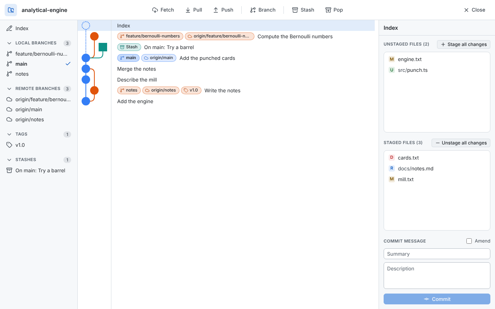
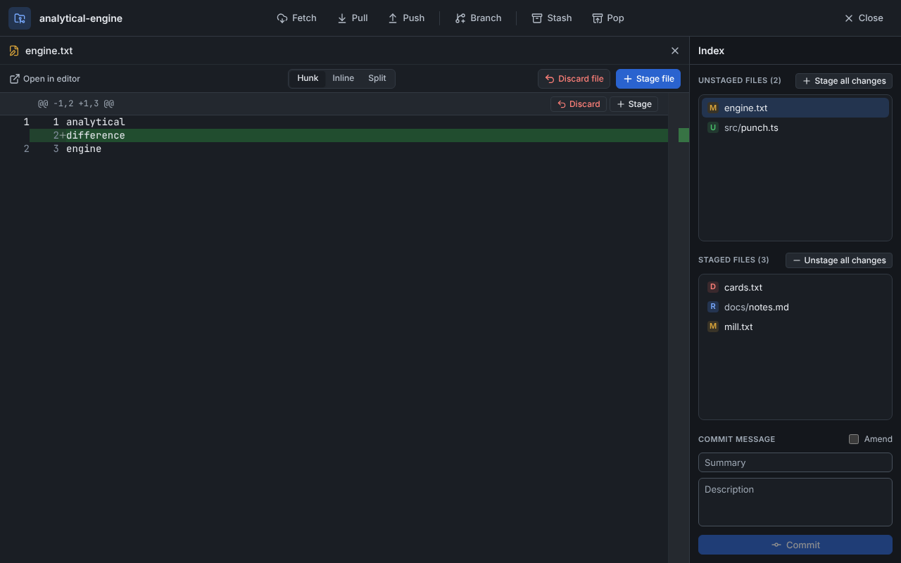

# Gitadmin

Gitadmin is a modern graphical user interface for Git. It is open-source, multiplatform and easy to use. It is based on [gitamine](https://github.com/pvigier/gitamine) by Pierre Vigier.

The main features of Gitadmin are:

* Beautiful and readable commit graph, as a list or on a canvas you can pan and zoom, with a minimap, that stays smooth on histories of tens of thousands of commits
* Quick filters to show only the current branch or the local branches, or to hide remote branches, tags and stashes, remembered per repository
* Highlight the commits that match words of their message, their author or SHA, or a date range (`after:2024-01 before:2024-03-15`)
* Focus on a few branches to see only their history and how they relate: merge base, fork points, commits ahead and behind, merges between them
* Works with SSH and HTTPS remotes with or without an SSH agent: asks for the passphrase of a key, the password of a server or an access token when needed, asks before trusting a new host, and can use a chosen key per host
* Syntax highlighting
* Themeable (light and dark modes available)
* Automatic refresh
* No account required and no telemetry

Gitadmin is powered by awesome technologies including:

* [TypeScript](https://www.typescriptlang.org/)
* [Node.js](https://nodejs.org/)
* [Electron](https://electronjs.org/)
* [React](https://reactjs.org/)
* [Monaco](https://github.com/Microsoft/monaco-editor)
* [Git](https://git-scm.com/), bundled with [dugite](https://github.com/desktop/dugite)
* [chokidar](https://github.com/paulmillr/chokidar)

If you want to know more about the commit graph drawing algorithm, you can read this [article](https://pvigier.github.io/2019/05/06/commit-graph-drawing-algorithms.html).

## Running from source

```
npm install
npm start
```

Run `npm run make` to build installers for your platform.

## Development

You need [Node.js](https://nodejs.org/) 24 (see `.nvmrc`). Git does not need to be installed, the app ships its own copy through dugite.

```sh
npm install
npm start          # build and run the app
npm test           # unit tests, and integration tests of the git layer
npm run test:e2e   # end-to-end tests of the app (uses xvfb-run on Linux CI)
npm run lint
npm run typecheck
npm run package    # package the app for the current platform
npm run make       # build the installers for the current platform
```

`npm run make` builds a zip on every platform, plus a Squirrel installer on Windows, a dmg on macOS and a deb package, an rpm package and an AppImage on Linux. On Linux it needs `dpkg` and `fakeroot` for the deb package, `rpmbuild` for the rpm package and `mksquashfs` for the AppImage, for example `sudo apt install dpkg fakeroot rpm squashfs-tools` on Debian and Ubuntu, or `sudo dnf install dpkg fakeroot rpm-build squashfs-tools` on Fedora. To build only some of them, pass the makers to Electron Forge: `npm run build && npx electron-forge make --targets @electron-forge/maker-zip,@electron-forge/maker-deb`.

The stylesheet is written in LESS in `assets/less` and compiled to `assets/css` by `npm run build` (or `npm run build:css` alone). The colors come from the themes in `assets/themes`.

The end-to-end tests compare screenshots of the main views in the light and dark themes with the images of `test/e2e/screenshots.spec.ts-snapshots`. They run on Linux only. After a visual change, record them again with `npm run test:e2e:update-snapshots` (with `xvfb-run -a` on a Linux machine without a display), check the new images and commit them.

## Releasing

Push a branch named `release/<version>`, for example `release/1.2.0`:

```sh
git switch -c release/1.2.0
git push -u origin release/1.2.0
```

The release workflow runs the checks, builds the installers and publishes them in a GitHub release tagged `v1.2.0`. The version is taken from the branch name, `package.json` does not need to be bumped. A version with a suffix, such as `1.2.0-beta.1`, is published as a pre-release.

| OS | Architectures | Without installation | Installers |
|---|---|---|---|
| Linux | x64, arm64 | `.AppImage`, `-portable.zip` | `.deb`, `.rpm` |
| Windows | x64, arm64 | `-portable.zip` | `Setup.exe` |
| macOS | arm64, x64 | `-portable.zip` | `.dmg` |

The portable zips contain the app ready to run: unzip and start `gitadmin.exe`, `Gitadmin.app` or `gitadmin`. The AppImage is a single file to make executable (`chmod +x`) and run.

The packages are not signed yet, so macOS and Windows warn about them the first time they are opened.

## Contributing

Here are some ways, you can contribute to Gitadmin:

* Found a bug, please create an issue, I will try to fix it as quickly as possible.
* Want to fix an issue or add a feature yourself, do a pull request.
* If you are a designer, Gitadmin needs an application icon and some icons for the user interface, you are more than welcome.
* If you want to become an active maintainer, please contact me.

## Screenshots




## License

Gitadmin is distributed under the [GNU GENERAL PUBLIC LICENSE version 3](https://www.gnu.org/licenses/gpl-3.0.en.html).

You are free to use Gitadmin for non-commercial and commercial projects without any restriction.
